# CI/CD Demo for a Java Web Application

This project demonstrates an end-to-end DevOps workflow for a Java web application using Maven, Docker, Kubernetes, GitHub Actions, and Ansible. The application exposes a simple REST API and health endpoint, and the pipeline automatically builds, tests, packages, and deploys the service whenever changes are pushed to the repository.

## Project architecture

```mermaid
flowchart LR
    A[Developer pushes code] --> B[GitHub Repository]
    B --> C[GitHub Actions workflow]
    C --> D[Maven: build + test]
    D --> E[Docker build + tag]
    E --> F[Push image to GHCR]
    F --> G[Kubernetes deployment]
    G --> H[LoadBalancer service]
    H --> I[Browser / HTTP endpoint]
```



## Tech stack

- Java 17
- Maven
- Spring Boot 3.3.4
- Docker
- Kubernetes
- GitHub Actions
- Ansible
- Azure Kubernetes Service (AKS) deployment target

## Local development

### Prerequisites

- Java 17+
- Maven 3.9+
- Docker Desktop or a Docker engine
- kubectl (for Kubernetes validation)

### Run the app locally

```bash
mvn clean test
mvn spring-boot:run
```

Then open the following endpoints in the browser:

- http://localhost:8080/
- http://localhost:8080/health
- http://localhost:8080/api/version

### Build the Docker image locally

```bash
docker build -t cicd-demo:local .
docker run --rm -p 8080:8080 cicd-demo:local
```

## CI/CD pipeline overview

The GitHub Actions workflow performs the following stages:

1. Check out the full repository history.
2. Scan the repository for leaked secrets with Gitleaks.
3. Check out the source code.
4. Install Java 17 and Maven dependencies.
5. Run the automated test suite.
6. Package the application into a JAR file.
7. Build the Docker image.
8. Push the image to GitHub Container Registry.
9. Authenticate to Azure.
10. Update the AKS deployment with the new image.
11. Wait for the rollout to finish.

The deployment files are in the `k8s/` folder.

### Security scanning choice

Gitleaks was selected for this coursework because the most important immediate CI/CD security risk is accidentally committing credentials, tokens, private keys, or connection strings. The `secret-scan` job runs before the build job and blocks image publication and deployment if a secret is detected. SonarQube is useful for maintainability, bugs, and code-quality metrics, but it requires a server or SonarCloud project and is less directly related to this small repository's primary release risk.

### GitHub and Azure configuration

The deployment job uses GitHub OIDC federation; it does not require a stored Azure client secret. Configure an Entra application/service principal with a federated credential whose subject is:

```text
repo:josondev@163281456/DevOps-Cia-2@1438010085:ref:refs/heads/main
```

Grant that identity only the required AKS deployment permissions. In the GitHub repository, add these Actions **variables**:

| Variable | Value |
|---|---|
| `AZURE_CLIENT_ID` | Entra application (client) ID |
| `AZURE_TENANT_ID` | Azure tenant ID |
| `AZURE_SUBSCRIPTION_ID` | Azure subscription ID |
| `AZURE_RESOURCE_GROUP` | Resource group containing the AKS cluster |
| `AZURE_AKS_CLUSTER_NAME` | AKS cluster name |

The workflow publishes the image to the public GHCR package `ghcr.io/josondev/cicd-demo`, so AKS can pull it without a registry credential.

## Live Azure deployment

- GitHub repository: https://github.com/josondev/DevOps-Cia-2
- AKS cluster: `devops-cia2-aks` in `new-devops-cia2-rg` (`centralindia`)
- Public landing page: http://4.187.190.194/
- Health: http://4.187.190.194/health
- Deployed version: http://4.187.190.194/api/version
- Live deployment link: http://4.187.190.194/
- Successful pipeline run: https://github.com/josondev/DevOps-Cia-2/actions/runs/40830334794
- Security scan: Gitleaks runs as the first required GitHub Actions job.

The demo deployment uses one `Standard_D2s_v4` AKS node and two application replicas. AKS Free tier does not make the worker VM, disk, or public networking free; these resources consume Azure for Students credit while running.

The root URL serves a responsive landing page with the current deployment status, version, environment, project links, and API links. It is served by Spring Boot from the deployed container, so it is available publicly through the AKS LoadBalancer rather than only on localhost.

## Kubernetes deployment

Apply the manifests with:

```bash
kubectl apply -f k8s/namespace.yaml
kubectl apply -k k8s/
```

Create the namespace once with an administrator identity. The deployment and service manifests are then applied by Kustomize in the `cicd-demo` namespace. The deployment runs two replicas and exposes the application through a `LoadBalancer` service. The CI identity can be scoped to that namespace rather than receiving cluster-wide write access.

## Ansible automation

The Ansible example in `ansible/playbook.yml` demonstrates how to create the target namespace and apply the Kubernetes manifests to a cluster.

```bash
ansible-playbook -i ansible/inventory/hosts.ini ansible/playbook.yml
```

## Security and operational considerations

- Use GitHub OIDC or secretless Azure authentication in production.
- Run Gitleaks or an equivalent secret scanner before building and deploying.
- Store registry credentials and cloud credentials in GitHub Secrets.
- Avoid exposing application secrets in YAML manifests.
- Configure image scanning and container vulnerability checks.
- Use ingress and TLS termination when exposing the app externally.

## Deployment checklist

- GitHub repository configured with the correct workflow permissions.
- Azure OIDC identity federated to the repository's `main` branch.
- Cluster, resource group, and identity values stored as GitHub Actions variables.
- GHCR package visibility set to public for unauthenticated AKS image pulls.
- A custom domain and TLS ingress are not configured in this coursework demo.

## Why this design works

This solution follows the requirements of a modern end-to-end CI/CD implementation: source code is version controlled, automated tests run on every change, the application is packaged in a container, the image is pushed to a registry, and Kubernetes updates the running service without manual intervention.


sample line
# devops
